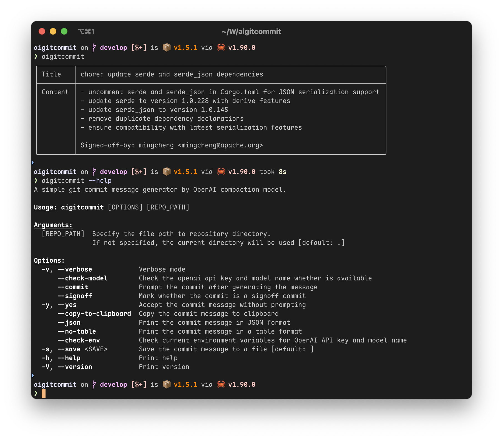

# AIGitCommit

[](https://github.com/mingcheng/aigitcommit/actions)
[](https://www.bestpractices.dev/projects/11285)
[](https://crates.io/crates/aigitcommit)



`AIGitCommit` is a command-line tool that generates meaningful, semantic commit messages from your staged Git changes using AI.

It inspects your diffs, summarizes the intent of your changes, and produces clear, concise commit messages that follow the [Conventional Commits](https://www.conventionalcommits.org/en/v1.0.0/) specification.

<a href="https://www.producthunt.com/products/aigitcommit/reviews?utm_source=badge-product_review&utm_medium=badge&utm_source=badge-aigitcommit" target="_blank"></a>

## References

- [Conventional Commits Specification](https://www.conventionalcommits.org/en/v1.0.0/)
- [Understanding Semantic Commit Messages](https://nitayneeman.com/blog/understanding-semantic-commit-messages-using-git-and-angular/)
- [Commit Message Best Practices](https://ssshooter.com/2020-09-30-commit-message/)

## Contributing

Contributions are welcome! Please feel free to submit issues, feature requests, or pull requests on [GitHub](https://github.com/mingcheng/aigitcommit).

## License

This project is licensed under the MIT License. See the [LICENSE](LICENSE) file for details.

## Features

- **AI-Powered Commit Messages**: Automatically generates meaningful, semantic commit messages from staged Git changes
- **Conventional Commits**: Follows the [Conventional Commits](https://www.conventionalcommits.org/en/v1.0.0/) specification for consistent, structured messages
- **Multiple Output Formats**:
  - Human-readable table view (default)
  - JSON format for CI/CD integration and automation
  - Plain text output
- **Flexible Workflow**:
  - Direct commit with `--commit` flag
  - Copy to clipboard with `--copy-to-clipboard`
  - Git hook integration for automatic message generation
- **Interactive & Non-Interactive**: Confirmation prompts by default, skip with `--yes` for scripting
- **Git-Native Operations**: Uses libgit2 for diffs, history, and commits; Git CLI config lookup preserves conditional-include behavior
- **Prompt-Injection Defenses**: Layered safeguards help reduce malicious instructions and unsafe output. [Learn more](#prompt-injection-defenses).
- **Multi-Provider Support**: Compatible with OpenAI and other OpenAI-compatible APIs (Azure OpenAI, local models, etc.)
- **Flexible Configuration**:
  - Environment variables for API settings
  - Git config for repository-specific or global settings
  - Configurable API base URL, token, proxy, and timeouts
- **Sign-off Support**: Auto sign-off via `AIGITCOMMIT_SIGNOFF` environment variable or `git config aigitcommit.signoff`
- **Local Response Cache**: Reuses previous results when nothing has changed, avoiding redundant API calls
- **Bounded, Accurate Context**: Preserves diff signs and indentation, budgets large patches per file, and retains metadata for every staged file
- **Generation Guidance**: Use `--instructions` for intent or scope and `--language` for professional prose in your preferred language, without changing the staged snapshot
- **Proxy Support**: HTTP and SOCKS5 proxies via `OPENAI_API_PROXY`


## How It Works

AIGitCommit streamlines your commit workflow by:

1. **Analyzing Changes**: Inspects staged changes using `git diff --cached`
2. **Understanding Context**: Examines recent commit history for stylistic consistency
3. **AI Generation**: Sends diffs to an OpenAI-compatible model with carefully crafted prompts
4. **Structured Output**: Generates commit messages following Conventional Commits specification
5. **User Review**: Presents the message for review and optional editing

The tool uses libgit2 for diff and history operations. It omits lock-file content
while retaining filenames, change status, blob IDs, and modes. Binary files,
deletions, exact renames, and mode-only changes remain visible to the model;
dependency manifests such as `go.mod` retain their patches.

Diff context preserves additions, deletions, blank lines, and indentation.
The default budget is **24,000 serialized JSON bytes**, shared across file
patches after reserving metadata for all staged files. Within each file, hunks
share the budget and additions, deletions, and context receive separate shares.
Unused space from small line groups is reused within their hunk. This keeps a
large replacement from hiding its added lines or later small fixes. Hunk
excerpts explicitly mark omissions; their retained lines may not be adjacent.
Smaller files are not crowded out by the first large file. If even file metadata
cannot fit, generation stops with an
actionable error instead of silently dropping files. This is a byte budget,
not a model-specific token count; system instructions and user guidance are
additional. Recent history is limited to five subjects of 200 characters each.

## Prompt-Injection Defenses

AIGitCommit uses layered safeguards without extra AI requests:

- **Separate data from instructions** to reduce manipulation through repository content.
- **Restrict model capabilities**: no command execution, file access, or link fetching.
- **Validate generated and cached messages** before use, rejecting terminal control
  sequences and forged signoff or attribution.

These safeguards reduce risk, not eliminate it. Review messages before committing.
Staged content and recent commit subjects are sent to your configured provider;
secrets are not automatically redacted.

## Installation

### From crates.io (Recommended)

```bash
cargo install aigitcommit
```

### From Source

For the latest development version:

```bash
cargo install --git https://github.com/mingcheng/aigitcommit.git
```

Both commands will download, compile, and install the binary to your Cargo bin directory (typically `~/.cargo/bin`). Ensure this directory is in your `PATH`.

### Prebuilt Binaries

Download a versioned archive and `SHA256SUMS` from
[GitHub Releases](https://github.com/mingcheng/aigitcommit/releases).
Archives contain the binary, README, and license for Linux and macOS, on both
x86_64 and ARM64. Linux binaries are built on Ubuntu 24.04 (glibc 2.39);
macOS binaries target macOS 13 or later.

Verify a downloaded archive before extracting it:

```bash
sha256sum --ignore-missing --check SHA256SUMS
tar -xzf aigitcommit-<version>-<target>.tar.gz
```

On macOS, use `shasum -a 256` to compare the archive's hash with `SHA256SUMS`.
Install the extracted `aigitcommit` binary into a directory on your `PATH`.

### Docker Image

Run AIGitCommit in Docker without installing the binary locally.
Images are published to `ghcr.io/mingcheng/aigitcommit` for `linux/amd64` and
`linux/arm64`. Pin a release with `:<version>` (without the `v` prefix), or use
`:latest` for the most recently published stable release. Prereleases receive
only their version tag and never update `latest`; any `+` in a version's build
metadata is replaced with `_` in the Docker tag.

**Read-only mode** (generate message only):

```bash
docker run \
  --rm \
  -v $PWD:/repo:ro \
  -e OPENAI_API_BASE='<api base>' \
  -e OPENAI_API_TOKEN='<api token>' \
  -e OPENAI_API_MODEL='<model name>' \
  -e OPENAI_API_PROXY='<proxy if needed>' \
  ghcr.io/mingcheng/aigitcommit
```

**Interactive mode** (with `--commit` flag):

```bash
docker run \
  --rm \
  -it \
  -v $PWD:/repo:rw \
  -e OPENAI_API_BASE='<api base>' \
  -e OPENAI_API_TOKEN='<api token>' \
  -e OPENAI_API_MODEL='<model name>' \
  -e OPENAI_API_PROXY='<proxy if needed>' \
  ghcr.io/mingcheng/aigitcommit --commit --yes
```

Note: Use `--yes` to skip interactive confirmations in non-TTY environments.

### Git Hook

AIGitCommit includes a `prepare-commit-msg` hook that automatically generates commit messages during your workflow.

**Quick install (recommended)**

Install into the current repository:

```bash
aigitcommit install-hook .
```

Install into a specific repository:

```bash
aigitcommit install-hook /path/to/repo
```

If a `prepare-commit-msg` hook already exists, it is renamed to
`prepare-commit-msg.bak` before the new hook is written, so your previous
hook is preserved (any prior `.bak` is overwritten).

Prerequisite: `aigitcommit` is installed and available in your `PATH`.

**Prerequisites**

- `aigitcommit` must be installed and available in your `PATH`
- Configure required environment variables before committing (see [Configuration](#configuration))

**Manual install (alternative)**

```bash
cp hooks/prepare-commit-msg .git/hooks/prepare-commit-msg
chmod +x .git/hooks/prepare-commit-msg
```

**Disable for a single commit**: Use `git commit --no-verify` to bypass the hook.

**Global installation (optional)**

Use Git templates so new repos have the hook:

```bash
mkdir -p ~/.git-template/hooks
cp hooks/prepare-commit-msg ~/.git-template/hooks/prepare-commit-msg
chmod +x ~/.git-template/hooks/prepare-commit-msg
git config --global init.templateDir ~/.git-template
```

Apply to an existing repo (either copy the file or re-init):

```bash
cp ~/.git-template/hooks/prepare-commit-msg <repo>/.git/hooks/
# or
cd <repo> && git init
```

**Hook behavior (summary)**

- Triggers on `git commit` with no message or with `-m ""`.
- Skips merge/rebase/cherry-pick and commits with an existing message.

**Troubleshooting**

- **"No staged changes detected"**: Run `git add` to stage your changes before committing
- **"aigitcommit is not installed"**: Ensure the binary is in your `PATH` or install it first
- **Missing configuration error**: Export required environment variables (`OPENAI_API_TOKEN`, etc.) in your shell
- **Hook output too verbose**: Redirect stderr in your Git configuration: `git config core.hookStderr false`

## Configuration

### Environment Variables

Configure AIGitCommit by setting these environment variables (in your shell profile, `.bashrc`, `.zshrc`, etc.):

**Required:**
- `OPENAI_API_TOKEN`: Your OpenAI-compatible API authentication token

**Optional:**
- `OPENAI_API_BASE`: API endpoint URL, default `https://api.openai.com/v1`
- `OPENAI_API_MODEL`: Model identifier, default `gpt-5` when unset. An explicitly empty value is rejected. Use the provider's exact model ID, including namespaces such as `openai/gpt-5.4-mini` on ZenMux.
- `OPENAI_API_PROXY`: HTTP/SOCKS5 proxy URL (e.g., `http://127.0.0.1:1080`, `socks5://127.0.0.1:1086`)
- `OPENAI_API_TIMEOUT`: HTTP request timeout in seconds. Unset, empty, invalid, or `0` means "use the HTTP client default (no timeout)"
- `OPENAI_API_MAX_TOKENS`: Maximum completion-token budget. Use `auto` (default) for the model-aware settings below, a positive integer to override, or `0` to omit the field. Token accounting, including reasoning, varies by provider; increase the limit if a completion is truncated.
- `OPENAI_API_REASONING_EFFORT`: `auto` (default), `off`, `none`, `minimal`, `low`, `medium`, `high`, or `xhigh`. `off` omits the field; `none` asks a supporting model to disable reasoning. Explicit values require provider/model support.
- `AIGITCOMMIT_SIGNOFF`: Enable auto sign-off (`true`, `1`, `yes`, `on`)
- `AIGITCOMMIT_ATTRIBUTION`: Append `Generated-by: aigitcommit v<version>` only when signoff is enabled; default `false`. Accepts `true`/`false`, `1`/`0`, `yes`/`no`, or `on`/`off`. Overridden by `--attribution` or `--attribution=false`.
- `AIGITCOMMIT_LANGUAGE`: Output language name or locale (for example `English`, `zh-CN`, or `Simplified Chinese`); default professional English. Overridden by `--language`. Empty/whitespace-only values and control characters are rejected.
- `AIGITCOMMIT_MAX_DIFF_BYTES`: Serialized diff budget, default `48000`, minimum `4096`; overridden by `--max-diff-bytes`
- `AIGITCOMMIT_DIFF_CONTEXT_LINES`: Unchanged lines per hunk, default `3`; overridden by `--diff-context-lines`

These names are fixed: no legacy environment-variable aliases are read.
`--model` overrides `OPENAI_API_MODEL`. `--check-env` reports only whether each
documented variable is set, never its value.

Automatic request settings:

| Endpoint / model | Reasoning effort | Completion-token budget |
| --- | --- | --- |
| ZenMux: `openai/gpt-5.4-mini`, `deepseek/deepseek-v4.1-flash` | `none` | `512` |
| ZenMux: `anthropic/claude-haiku-5.5`, `anthropic/claude-sonnet-5.5` | omitted | `512` |
| GPT-5 family except chat/pro variants; `grok-4.5`, `grok-4.6`, `grok-4.7` | `low` | `2048` |
| Other models | omitted | omitted |

ZenMux-specific settings apply only to HTTPS endpoints on `zenmux.ai`.
OpenAI and xAI model detection also accepts their `openai/` and `x-ai/`
namespaces without changing the model ID sent to the API. Explicit settings
override the table. Unknown models receive no speculative provider-specific
tuning, and generation never silently switches models.

For OpenAI-compatible providers that reject optional request fields, set
`OPENAI_API_REASONING_EFFORT=off` and
`OPENAI_API_MAX_TOKENS=0`. Generation makes one chat request on a
cache miss, without a model-list preflight or automatic format-repair call
(the API client's transient-error retry policy still applies).

**Example configuration:**

```bash
# ~/.bashrc or ~/.zshrc
export OPENAI_API_TOKEN="sk-..."
export OPENAI_API_BASE="https://api.openai.com/v1"
export OPENAI_API_MODEL="gpt-5"
export OPENAI_API_PROXY="http://127.0.0.1:1080"  # Optional
export AIGITCOMMIT_SIGNOFF="true"                # Optional
export AIGITCOMMIT_ATTRIBUTION="false"           # Optional, requires signoff
export AIGITCOMMIT_LANGUAGE="English"            # Optional
```

You can store local credentials in `.env` (ignored by Git). The CLI reads the
process environment, **not `.env` automatically**. Keep the file private
(`chmod 600 .env`) and only load files you trust. For a shell-compatible `.env`,
this command works when launched from Bash or Fish:

```bash
bash -c 'set -a; source .env; set +a; exec aigitcommit'
```

For ZenMux, configure the endpoint and a qualified model explicitly:

```bash
export OPENAI_API_BASE="https://zenmux.ai/api/v1"
export OPENAI_API_MODEL="openai/gpt-5.4-mini"
export OPENAI_API_MAX_TOKENS="512"
# OPENAI_API_REASONING_EFFORT=auto selects the tested no-reasoning profile
aigitcommit --check-model
aigitcommit --json
```

Model availability and routing latency can change. `--check-model` queries the
configured provider; normal generation skips this extra network round trip.

### Git Configuration

You can also enable sign-off via Git configuration (takes precedence over environment variables):

```bash
# Repository-specific
git config aigitcommit.signoff true

# Global (all repositories)
git config --global aigitcommit.signoff true
```

### Verify Configuration

Check your environment setup:

```bash
# Verify all environment variables
aigitcommit --check-env

# Test API connectivity and model availability
aigitcommit --check-model

# Show all available options
aigitcommit --help
```

## Usage

### Basic Usage

Run AIGitCommit in a Git repository with staged changes:

```bash
# In the current repository
aigitcommit

# Specify a different repository path
aigitcommit /path/to/repo
```

The tool will:
1. Analyze your staged changes (`git diff --cached`)
2. Generate a Conventional Commit message using AI
3. Display the result in table format (default)

### Command-Line Options

**Output Formats:**
- Default: Table view (easy to read)
- `--json`: JSON output (for CI/automation)
- `--no-table`: Plain text output

**Actions:**
- `--commit`: Automatically commit with the generated message
- `--copy-to-clipboard`: Copy the message to clipboard
- `--yes`: Skip confirmation prompts (useful for scripting)
- `--signoff`: Append `Signed-off-by` line to the commit
- `--attribution[=true|false]`: Add tool name/version after the signoff trailer; disabled by default and has no effect without signoff
- `--save <file>`: Save the generated commit message to the given file

**Cache:**
- `--no-cache`: Bypass the local cache for this run
- `--clear-cache`: Remove cached entries for the current repository and exit

**Generation:**
- `--model <name>`: Override `OPENAI_API_MODEL` for generation or `--check-model`; no automatic provider/model switching
- `--language <language>`: Language of the title description and body bullets; default professional English
- `--instructions <text>`: Additional intent or scope guidance; the configured language takes precedence over conflicting language guidance
- `--max-diff-bytes <bytes>`: Adjust the serialized staged-diff budget
- `--diff-context-lines <lines>`: Adjust unchanged context around each hunk

**Diagnostics:**
- `--check-env`: Verify environment variable configuration
- `--check-model`: Test API connectivity and model availability
- `--help`: Show all available options

### Examples

**Generate and review message:**
```bash
aigitcommit
```

**Auto-commit without confirmation:**
```bash
aigitcommit --commit --yes
```

**Copy message to clipboard:**
```bash
aigitcommit --copy-to-clipboard
```

**JSON output for CI pipelines:**
```bash
aigitcommit --json | jq '.title'
```

**Commit with sign-off:**
```bash
aigitcommit --commit --signoff
```

**Generate Chinese prose with sign-off and tool attribution:**
```bash
aigitcommit --language zh-CN --signoff --attribution
```

Only the title description and body prose change language. Conventional Commit
types (`fix`, `feat`, etc.), scope/code identifiers, punctuation, JSON keys, and
trailer names stay unchanged. Use `--language` rather than `--instructions` to
select the language.

Attribution is added locally, not generated by the model, and uses the running
binary's package version. It records the tool rather than inventing a human
co-author or email address. When signoff is enabled by CLI, environment, or Git
config, the optional trailer block is:

```text
Signed-off-by: Your Name <your.email@example.com>
Generated-by: aigitcommit v<version>
```

Both trailers appear consistently in plain text, JSON content, table output,
saved files, clipboard copies, and commits. Changing language creates a separate
cache entry; toggling signoff or attribution reuses the generated text and
applies trailers locally.

### Local Cache

Responses are cached under the repository's Git directory in
`aigitcommit-cache/` and keyed by the API endpoint and exact serialized request:
model, request tuning, rendered prompts, user guidance, staged context, and
recent subjects. Blob IDs in file metadata invalidate the entry even if a
change is inside omitted lock-file content or a truncated patch. Credentials
are not part of the key. Older cache entries are not reused.

Only complete, validated messages are cached. Empty, refused, truncated, or
malformed responses produce an error; malformed cache entries trigger a fresh
request with a warning. CRLF and a single enclosing plain-text Markdown fence
are normalized locally without another model call, as is a missing blank line
between an otherwise valid title and bullet body. Use `--no-cache` to bypass
both reads and writes for a single run, or `--clear-cache` to wipe the cache.

### Workflow Integration

#### VS Code and AI agents

Use the same staged snapshot you review in VS Code Source Control. Like an
editor's commit-message generation action, generation does not stage files,
modify your working tree, or create a commit unless you pass `--commit`.
Partially staged files contribute only their staged content, not later edits.
This CLI uses your configured OpenAI-compatible endpoint; it does not access
VS Code Copilot authentication or use a Copilot subscription.

```bash
# Generate from the staged selection, adding intent that the diff may not explain
aigitcommit --instructions "focus on fixing empty-input handling"

# Request Chinese prose while retaining the Conventional Commit structure
aigitcommit --language zh-CN

# Agent/tool integration: machine-readable stdout, diagnostics on stderr
aigitcommit --json > /tmp/commit-message.json

# Use the result in an editor's commit message box
aigitcommit --copy-to-clipboard

# More context for a broad refactor
aigitcommit --max-diff-bytes 96000 --diff-context-lines 5
```

Review generated messages, especially when truncation warnings appear.
The title and one-to-five-bullet body are validated before output or commit.
Use `--verbose` to inspect API elapsed time, token usage (when supplied by the
provider), reasoning-token counts (not reasoning text), and cache hits on stderr.
Bounded inputs and lower reasoning effort
reduce request work, but actual latency and semantic quality depend on the
provider/model; there is no fixed speedup guarantee.

For xAI endpoints with access to `grok-4.5`, use
`aigitcommit --model grok-4.5` for a low-reasoning option without changing your
saved model selection. `grok-build-0.1` does not support `reasoning_effort`;
forcing `low` or `none` is not a valid way to speed it up. Non-reasoning models
can be faster but may sacrifice type selection and factual accuracy. Compare
representative diffs rather than choosing solely by latency.

**Typical workflow:**
```bash
# Stage your changes
git add .

# Generate and review commit message
aigitcommit

# Or commit directly
aigitcommit --commit

# Or use the Git hook (if installed)
git commit  # Hook generates message automatically
```

## License

This project is licensed under the MIT License. See the `LICENSE` file for details.
